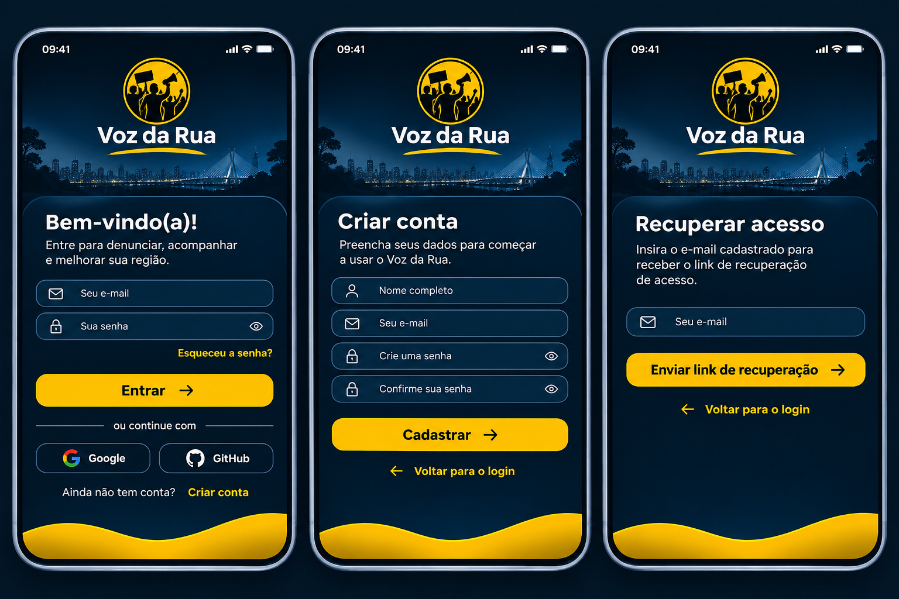
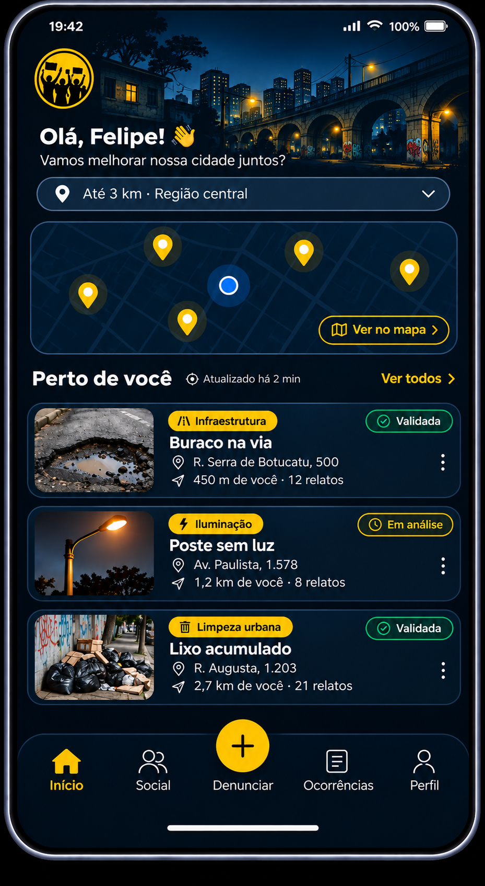
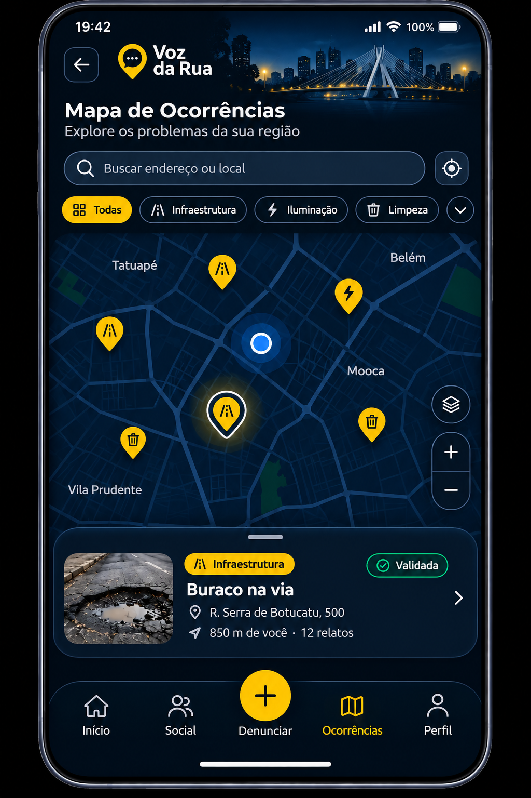
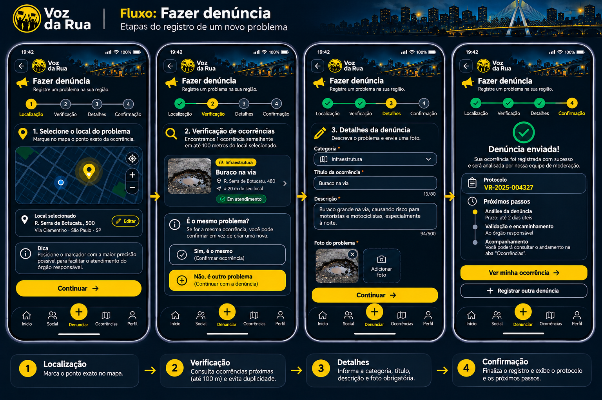
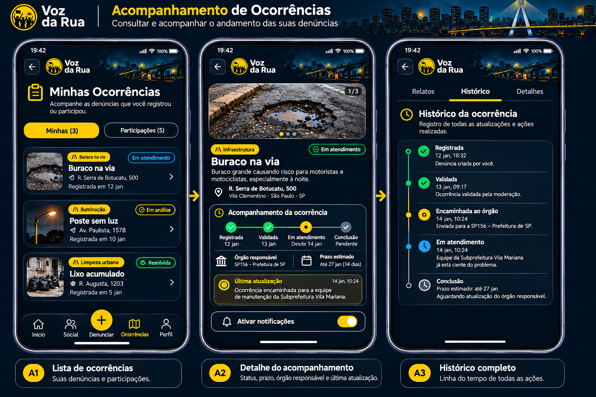

<div align="center">


# Voz da Rua

### Cidadania, colaboração e tecnologia para transformar problemas urbanos em ação.

[](docs/STATUS.md)
[](backend/package.json)
[](docs/DECISOES_TECNICAS.md)
[](docs/database/README-DB.md)
[](LICENSE)

**Descubra o que acontece perto de você. Relate problemas. Confirme ocorrências. Encontre o canal oficial adequado.**

[Objetivo](#objetivo) · [Funcionalidades](#funcionalidades-do-mvp) · [Telas](#experiência-e-referências-visuais) · [Arquitetura](#arquitetura) · [Executar localmente](#executando-localmente) · [Documentação](#documentação)

</div>

---

## Objetivo

O **Voz da Rua** é uma plataforma colaborativa, mobile-first, criada para organizar a identificação e o acompanhamento de problemas urbanos no município de São Paulo.

Buracos, falhas de iluminação, barreiras de acessibilidade e outros problemas do cotidiano costumam estar distribuídos entre diferentes canais de atendimento. O projeto aproxima três elementos que hoje ficam desconectados: **o cidadão, a ocorrência e o responsável por recebê-la**.

A plataforma permite localizar problemas próximos, registrar evidências, confirmar uma ocorrência existente, acompanhar sua evolução e acessar o canal oficial correspondente. O Voz da Rua **não substitui órgãos públicos ou seus sistemas de protocolo**; ele facilita o caminho até esses canais e preserva o histórico comunitário do problema.

## Como funciona

```text
Problema identificado na cidade
              │
              ▼
 Localização validada em São Paulo
              │
              ▼
 Busca de ocorrências semelhantes
        ┌─────┴─────┐
        │           │
    Já existe    Não existe
        │           │
        ▼           ▼
 "Eu também vi"  Nova ocorrência + foto
        │           │
        └─────┬─────┘
              ▼
       Moderação humana
              │
              ▼
 Publicação, acompanhamento e encaminhamento
```

O domínio usa proximidade geográfica como regra de negócio. Ações presenciais exigem localização válida, dentro do município atendido e a até **3 km** da ocorrência. A autoridade espacial é o PostgreSQL/PostGIS no backend — não o navegador ou o serviço de geocodificação.

## Funcionalidades do MVP

### Para o cidadão

- cadastro local com confirmação de e-mail, login e recuperação de acesso;
- Home com ocorrências em até 3 km, ordenadas por proximidade;
- mapa e filtros por categoria, distância e status;
- registro de ocorrência com localização, descrição e uma evidência fotográfica;
- detecção de possíveis duplicidades antes da criação;
- confirmação comunitária por meio do **“Eu também vi”**;
- detalhes, histórico e acompanhamento das ocorrências;
- área **Minhas ocorrências**, separando criações e participações;
- indicação de resolução e sinalização de reabertura;
- acesso orientado ao canal oficial responsável;
- perfil privado por padrão e área Social com exposição opt-in;
- notificações internas e preferências de comunicação.

### Para moderação e administração

- fila de análise com evidência, localização e possíveis duplicidades;
- validação, rejeição, marcação de duplicidade e seleção de imagem pública;
- decisões auditáveis de resolução, reabertura e arquivamento;
- gestão de usuários, categorias, canais e parâmetros conforme o papel;
- indicadores administrativos agregados, sem ampliar a coleta de dados pessoais.

> Vídeo, chat em tempo real, aplicativo nativo, escrita offline, outras cidades e acompanhamento automático de protocolos oficiais estão fora do MVP atual.

## Experiência e referências visuais

A interface segue uma direção **dark-first**, mobile-first e acessível, com azul-marinho, amarelo urbano, tipografia Sora e componentes confortáveis para uso em movimento. As imagens abaixo são referências de produto: dados, nomes, números e molduras são ilustrativos.

### Acesso e Home

<table>
  <tr>
    <td width="50%" align="center">
      
      <br><strong>Autenticação</strong><br>
      <sub>Login, criação de conta e recuperação.</sub>
    </td>
    <td width="50%" align="center">
      
      <br><strong>Home — Perto de você</strong><br>
      <sub>Mapa resumido e ocorrências próximas.</sub>
    </td>
  </tr>
</table>

### Mapa, denúncia e acompanhamento

<table>
  <tr>
    <td width="33%" align="center">
      
      <br><strong>Mapa</strong>
    </td>
    <td width="33%" align="center">
      
      <br><strong>Nova ocorrência</strong>
    </td>
    <td width="33%" align="center">
      
      <br><strong>Acompanhamento</strong>
    </td>
  </tr>
</table>

As referências possuem graus diferentes de aprovação. A Home e a linguagem visual de autenticação estão aprovadas como direção; o mapa expandido e alguns fluxos permanecem em validação. Consulte o [Design System](docs/Design/Design.md), a [especificação da Home](docs/Design/Home.md) e o [catálogo das imagens](docs/Design/references/README.md) antes de implementar uma tela.

## Diferenciais técnicos

- **Geografia confiável:** PostgreSQL 17 + PostGIS 3.6 decidem município, distâncias e regras espaciais.
- **Privacidade desde o domínio:** perfil privado por padrão, identidade oculta nos relatos e ausência de histórico contínuo de localização.
- **Autorização contextual:** sessão, papel, status da conta, ownership e estado do recurso são revalidados no servidor.
- **Moderação humana:** volume comunitário gera prioridade, mas não substitui decisões humanas nos fluxos de validação e reabertura.
- **Evidências protegidas:** originais privados; publicação somente de derivadas reprocessadas e aprovadas pela moderação.
- **Integridade transacional:** SQL parametrizado, migrations versionadas e concorrência tratada no banco real.
- **Offline seguro:** a PWA oferece leitura limitada; mutações não são enfileiradas sem revalidação de contexto.
- **Qualidade verificável:** testes HTTP, integração PostgreSQL/PostGIS, acessibilidade e jornadas E2E fazem parte dos gates planejados.

## Arquitetura

```text
React + Vite (PWA)
        │ REST/JSON — /api/v1
        ▼
Fastify + TypeScript
        │
        ├── Routes       → rotas e hooks
        ├── Controllers  → HTTP e DTOs
        ├── Services     → domínio, autorização e transações
        └── Repositories → SQL parametrizado
                │
                ├── PostgreSQL 17 + PostGIS 3.6 + pgcrypto
                ├── armazenamento S3 compatível para imagens
                └── Postmark / Mailpit para e-mail
```

### Stack aprovada

| Camada | Tecnologias |
|---|---|
| Frontend | React, TypeScript, Vite, PWA, MapLibre GL JS e MapTiler |
| Backend | Node.js 26 LTS, TypeScript, Fastify, `pg` e REST/JSON |
| Dados | PostgreSQL 17, PostGIS 3.6, pgcrypto e migrations SQL |
| Testes | Vitest, `fastify.inject()`, React Testing Library, Playwright e PostgreSQL/PostGIS real |
| Operação | Docker Compose no desenvolvimento; Nginx e HTTPS previstos para produção |

## Estado atual do projeto

O projeto está em **desenvolvimento ativo**. A documentação de produto, a arquitetura base, a autenticação, os controles de segurança, a jornada pública de acesso e partes das consultas de ocorrências já possuem implementação e testes. Integrações geográficas e operacionais ainda têm bloqueios documentados e **não estão aprovadas para produção**.

| Área | Situação resumida |
|---|---|
| Frontend | Jornada de acesso implementada; demais telas ainda seguem as referências de design |
| Backend | Fundação Fastify, autenticação, perfil e consultas preparatórias de ocorrências |
| Banco | Migrations `001–027`; testes experimentais com PostgreSQL/PostGIS real |
| Geografia | Pipeline e validações preparados; recurso territorial oficial atual bloqueado por topologia inválida |
| Produção | Não liberada; infraestrutura, scanners, staging e revisão humana permanecem pendentes |

O registro completo, com resultados efetivamente observados e limitações, está em [`docs/STATUS.md`](docs/STATUS.md). Problemas conhecidos são mantidos em [`docs/ERROS.md`](docs/ERROS.md).

## Estrutura do repositório

```text
backend/       API Fastify, domínio, persistência e testes
frontend/      aplicação React/Vite e testes de interface
db/            migrations SQL e seed exclusivo de desenvolvimento
docs/          PRD, FSD, decisões, design, contratos e progresso
geography/     fontes territoriais versionadas e sua procedência
infra/         imagens e recursos de infraestrutura
scripts/       setup, migrations, seed e verificações locais
```

## Executando localmente

### Pré-requisitos

- Node.js **26 LTS** e npm;
- Docker Desktop com Docker Compose, para as integrações locais;
- PowerShell 7+ no fluxo de preparação para Windows.

O repositório fornece um runtime Node portátil para Windows:

```powershell
./scripts/setup-node.ps1
```

### Frontend

```powershell
cd frontend
npm ci
npm run dev
```

### Backend

```powershell
cd backend
npm ci
npm run typecheck
npm test
npm run build
```

O backend valida as variáveis de ambiente no início. Não use credenciais reais em arquivos versionados e não copie configurações de produção para o ambiente local. Para banco, Mailpit, migrations, seed e limitações atuais das imagens, siga o [guia de ambiente P01](docs/AMBIENTE_P01.md).

## Qualidade, segurança e privacidade

Segurança é requisito de produto e condição de entrega. Entre as diretrizes do projeto estão:

- sessões server-side em cookie HttpOnly, Secure em produção e proteção CSRF;
- negação por padrão, RBAC e prevenção de IDOR no backend;
- validação de entrada, limites, rate limiting e erros sem detalhes internos;
- SQL parametrizado e credenciais de banco com menor privilégio;
- validação de magic bytes, decode, dimensões e remoção de EXIF em imagens;
- segredos fora do Git e auditoria de ações sensíveis;
- minimização de dados pessoais e tratamento de localização compatível com privacidade;
- revisão do [Security Gate SEC-001–125](docs/FSD/SECURITY_GATE_100.md) em cada entrega aplicável.

Mudanças executáveis devem incluir testes positivos, negativos e de autorização. Resultados experimentais não equivalem a aprovação de staging ou produção.

## Documentação

| Documento | Conteúdo |
|---|---|
| [PRD](docs/PRD/prd.md) | visão, requisitos funcionais e escopo do produto |
| [FSD](docs/FSD/FSD.md) | domínio, contratos, segurança e critérios de aceite |
| [Decisões técnicas](docs/DECISOES_TECNICAS.md) | stack e decisões arquiteturais aprovadas |
| [Design System](docs/Design/Design.md) | linguagem visual, fluxos e estados de aprovação |
| [Plano](docs/PLANO.md) | fases, dependências e critérios de execução |
| [Status](docs/STATUS.md) | progresso, verificações, limitações e pendências |
| [Erros conhecidos](docs/ERROS.md) | problemas, impacto, tratamento e estado |
| [Ambiente local](docs/AMBIENTE_P01.md) | preparação e validação da infraestrutura de desenvolvimento |

Em caso de divergência, não transforme uma proposta visual ou uma pendência em comportamento. Consulte as regras de precedência do FSD e das decisões técnicas e registre o conflito antes de alterar a parte afetada.

## Contribuindo

Contribuições devem respeitar o escopo da fase autorizada, os contratos documentados e as regras de segurança do repositório. Antes de desenvolver:

1. leia [`AGENTS.md`](AGENTS.md) e as fontes obrigatórias;
2. confirme a fase e as dependências no [`PLANO`](docs/PLANO.md);
3. consulte o FSD da área afetada e os contratos existentes;
4. inclua testes aplicáveis e atualize o status da entrega;
5. não faça commit, push, deploy ou altere decisões aprovadas sem autorização correspondente.

Features relevantes devem ser revisadas por Pull Request. Ainda não existe uma convenção obrigatória aprovada de branches ou mensagens de commit.

## Licença

Distribuído sob a [Apache License 2.0](LICENSE).

---

<div align="center">

**Voz da Rua** — tecnologia cívica para tornar problemas urbanos mais visíveis, verificáveis e encaminháveis.

</div>
